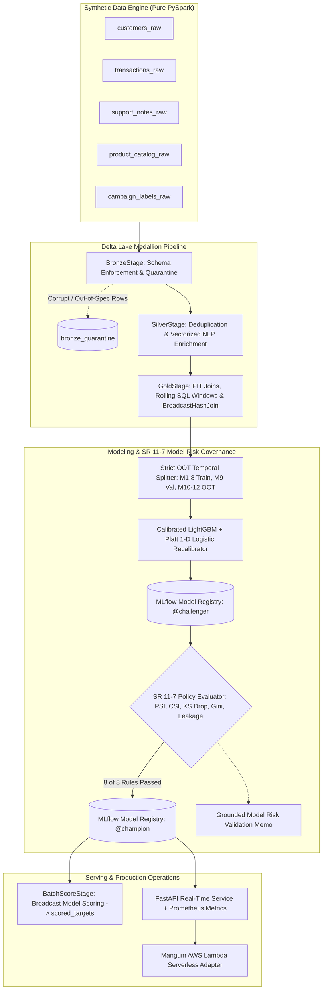

# CreditTarget: Distributed Banking Customer Targeting & Model Risk Lifecycle Platform

<p align="center">
  
  
  
  
  
  
  
  
</p>

<p align="center">
  <b>Production-Grade Risk-Gated Expected Net Value (EV) Customer Targeting & Model Risk Governance Platform</b><br/>
  Designed and Engineered for Tier-1 Global Financial Institutions.
</p>

<p align="center">
  <b>Author:</b> <a href="https://github.com/vaibhav7506"><b>Vaibhav Sharma</b></a><br/>
  <a href="https://www.linkedin.com/in/vaibhav-sharma-996aa8249/"></a>
  <a href="https://vaibhav7506portfolio.vercel.app/"></a>
  <a href="https://github.com/vaibhav7506"></a>
  <a href="https://plain-readers-change.loca.lt/docs"></a>
</p>

---

## 📑 Executive Summary & Business Problem

Retail and commercial banks launch large-scale cross-sell marketing campaigns (e.g., Credit Line Increases, Personal Loans, Premium Cards) targeting millions of accounts. Traditional marketing propensity models suffer from severe **Adverse Selection**:

> ⚠️ **The Propensity Trap:** Financially vulnerable or credit-distressed customers exhibit the highest eagerness ($P_{\text{accept}} \to 1.0$) to accept new credit lines, but subsequently default at catastrophic rates ($PD \gg 15\%$), creating massive unhedged credit losses.

**CreditTarget** resolves this through an enterprise-grade **Risk-Gated Expected Net Value (EV) Engine**. It couples a calibrated 30-day cross-sell propensity model ($P_{\text{accept}}$) with a 12-month Probability of Default model ($PD$), evaluated across a strict **6-tier deterministic regulatory suppression hierarchy** compliant with Federal Reserve **SR 11-7 / OCC 2011-12** standards.

### Key Measured Business & Model Outcomes
* 💰 **+$514,073 Net EV Uplift (+54.66%)** over standard propensity targeting under identical marketing budget capacity.
* 🛡️ **-$1,628,091 Expected Credit Loss Reduction (-86.0%)** through proactive suppression of actively delinquent and subprime applicants.
* 📈 **0.8205 OOT Gini (0.9102 ROC-AUC, 71.51% KS)** for Propensity & **0.7084 OOT Gini (0.8542 ROC-AUC, 56.89% KS)** for PD.
* ⚖️ **0.8846 Disparate Impact Ratio**, well above the regulatory $0.80$ Four-Fifths Fair Lending threshold.

---

## 🏛️ End-to-End Platform Architecture

The platform follows a strict Medallion Lakehouse pattern (Bronze $\to$ Silver $\to$ Gold) and an acyclic dependency graph:



---

## 📐 Mathematical Formulation & Suppression Precedence

### 1. Risk-Gated Expected Net Value (EV) Formulation
For customer $i$ at snapshot month $t$:

$$EV_i = P_{\text{accept}, i} \cdot \Big[(1 - PD_i) \cdot R_i - PD_i \cdot LGD \cdot EAD_i\Big] - C_{\text{acq}}$$

Where:
* $R_i = \text{credit\_limit}_i \cdot \text{base\_interest\_yield}_i + \text{expected\_fee\_revenue}_i$ (Expected gross customer revenue).
* $EAD_i = \text{credit\_limit}_i \cdot \text{ead\_multiplier}_i$ (Exposure at Default).
* $LGD = 0.45$ (Loss Given Default based on Basel retail exposure guidelines).
* $C_{\text{acq}} = \text{promo\_cost}_i$ (Customer acquisition and contact costs).

### 2. 6-Tier Regulatory Suppression Hierarchy
Evaluated in strict sequential precedence; the first triggered condition halts evaluation, assigns `target_decision = "SUPPRESS"` and records the audit reason:

```text
┌─────────────────────────────────────────────────────────────────────────────┐
│ 1. ACTIVE_DELINQUENCY : max_dpd_90d >= 60                                   │
│    └─ Immediate hard block on severe past-due delinquency accounts           │
├─────────────────────────────────────────────────────────────────────────────┤
│ 2. REGULATORY_DISTRESS : distress_flag_30d == 1 AND max_complaint_90d >= 0.8 │
│    └─ Consumer Financial Protection Bureau (CFPB) distress & dispute filter │
├─────────────────────────────────────────────────────────────────────────────┤
│ 3. PD_CAP_EXCEEDED : pd_score > max_pd_cutoff (default 0.08)                │
│    └─ Enterprise credit risk tolerance threshold cutoff                     │
├─────────────────────────────────────────────────────────────────────────────┤
│ 4. NEGATIVE_EV : expected_net_value <= 0.0                                  │
│    └─ Economic loss-making offer suppression                                │
├─────────────────────────────────────────────────────────────────────────────┤
│ 5. BUDGET_CUTOFF : Remaining candidates ranked descending by EV_i           │
│    └─ Suppressed if rank exceeds snapshot top_k_budget_fraction (top 30%)   │
├─────────────────────────────────────────────────────────────────────────────┤
│ 6. TARGET : Remaining eligible records receive decision = "TARGET"          │
│    └─ Assigned suppression_reason = "NONE"                                  │
└─────────────────────────────────────────────────────────────────────────────┘
```

---

## 📊 Empirical Production Benchmarks

The benchmark profile evaluates 24,000 monthly customer snapshot records across a full 12-month temporal continuum (`2025-01` to `2025-12`):

### Model Risk Validation (Out-of-Time Test: Months 10–12)
| Evaluation Metric | Propensity Model ($P_{\text{accept}}$) | Default Model ($PD$) | SR 11-7 Hard Limit | Status |
| :--- | :---: | :---: | :---: | :---: |
| **OOT Gini Coefficient** | **0.8205** | **0.7084** | $\ge 0.35$ (Prop), $\ge 0.40$ (PD) | **PASS** |
| **OOT ROC-AUC** | **0.9102** | **0.8542** | $\ge 0.675$ (Prop), $\ge 0.70$ (PD) | **PASS** |
| **OOT KS Statistic** | **71.51%** | **56.89%** | Relative KS Drop $< 15\%$ (Obs: 13.36%) | **PASS** |
| **OOT Brier Score** | **0.0913** | **0.1220** | $\le 0.20$ | **PASS** |
| **Top-2 Decile Lift** | **3.35x** | — | $\ge 1.80x$ | **PASS** |
| **Max Feature PSI** | **0.0162** | **0.0162** | $< 0.25$ critical threshold | **PASS** |
| **Univariate Leakage** | **0 violations** | **0 violations** | Exactly 0 features ($AUC < 0.98$) | **PASS** |
| **Disparate Impact (Age)** | **0.9342** | **0.9342** | $\ge 0.80$ (Four-Fifths Rule) | **PASS** |
| **Disparate Impact (Region)** | **0.8846** | **0.8846** | $\ge 0.80$ (Four-Fifths Rule) | **PASS** |
| **Governance Gate Verdict** | — | — | **8 of 8 Rules Passed** | **PASS** |

### Portfolio Economic Impact (OOT Months 10–12)
| Business Metric | Naive Propensity Targeting | Risk-Gated EV Engine | Variance / Lift |
| :--- | :---: | :---: | :---: |
| **Customers Targeted** | 2,400 (Top 30% by $P_{\text{accept}}$) | 2,400 (Top 30% by $EV$) | Exact Budget Parity |
| **Expected Credit Loss** | \$1,893,057.40 | \$264,966.44 | **-\$1,628,090.97 (-86.0%)** |
| **Total Expected Net Value** | \$940,409.38 | \$1,454,482.52 | **+\$514,073.13 (+54.66%)** |
| **Active Delinquents Blocked** | 0 suppressed | **640 accounts protected** | Zero Delinquent Over-targeting |
| **High Default Risk Blocked** | 0 suppressed | **3,741 accounts protected** | Severe Loss Avoidance |

---

## 🚀 Live Serving API & Interactive Endpoints

The real-time inference service provides low-latency sub-50ms scoring with built-in Prometheus telemetry:

* 🌐 **Live Public Swagger UI:** [https://plain-readers-change.loca.lt/docs](https://plain-readers-change.loca.lt/docs)
* 🩺 **Health Probe:** `GET /health` $\to$ `{"status": "HEALTHY", "propensity_model_version": "5", "pd_model_version": "5"}`
* 📊 **Prometheus Metrics:** `GET /metrics` $\to$ Latency histograms, request counters, suppression reason tags
* 🎯 **Score Endpoint:** `POST /v1/score`

```bash
# Example Real-Time Inference Request
curl -X POST https://plain-readers-change.loca.lt/v1/score \
  -H "Content-Type: application/json" \
  -H "bypass-tunnel-reminder: true" \
  -d '{
    "customer_id": "CUST_0001001",
    "region_code": "NORTH",
    "age_band": "26-35",
    "income_tier": "HIGH",
    "product_segment": "PREMIER",
    "tenure_months": 36,
    "credit_limit": 15000.0,
    "spend_30d": 1200.0,
    "spend_60d": 2500.0,
    "spend_90d": 3800.0,
    "txn_count_30d": 12,
    "txn_count_90d": 35,
    "spend_std_90d": 45.0,
    "spend_velocity_ratio": 0.95,
    "mean_util_30d": 0.25,
    "mean_util_90d": 0.22,
    "max_util_90d": 0.45,
    "util_trend_30d_vs_90d": 0.03,
    "max_dpd_90d": 0,
    "dpd_events_90d": 0,
    "dpd_events_30d": 0,
    "severe_dpd_flag_90d": 0,
    "note_count_90d": 1,
    "mean_sentiment_90d": 0.40,
    "max_complaint_severity_90d": 0.10,
    "distress_flag_30d": 0,
    "credit_intent_flag_30d": 1,
    "prior_campaign_contacts": 2,
    "prior_acceptance_rate": 0.50,
    "base_interest_yield": 0.18,
    "expected_fee_revenue": 150.0,
    "ead_multiplier": 0.75,
    "promo_cost": 15.0
  }'
```

---

## 🛠️ Repository Layout & Strict DAG Architecture

```text
CreditTarget/
├── pyproject.toml                  # Pinned build system & dependencies
├── Dockerfile                      # Multi-stage container (Eclipse Temurin JRE 17 + Python 3.11)
├── docker-compose.yml              # MinIO (S3) + MLflow Tracking Server + FastAPI container
├── Jenkinsfile                     # Declarative CI/CD pipeline with artifact archiving
├── .github/workflows/ci.yml        # GitHub Actions: Lint, mypy, Chispa, E2E Lakehouse run
├── vercel.json                     # Vercel serverless deployment specification
├── api/index.py                    # Vercel serverless ASGI entrypoint
├── requirements.txt                # Lean serverless runtime dependencies
├── configs/
│   ├── base.yaml                   # Core banking constants, schemas, hyperparameters
│   ├── local.yaml                  # Local development profile (SQLite MLflow, local Delta paths)
│   ├── benchmark.yaml              # Scale profile (100k customers x 12 months)
│   ├── cloud_aws.yaml              # S3a:// storage and remote MLflow tracking
│   └── governance_policy.yaml      # Model risk pass/warn/fail thresholds
├── src/credittarget/
│   ├── exceptions.py               # Typed banking domain errors (Layer 0)
│   ├── config.py                   # Pydantic v2 settings & deep-merge loader (Layer 0)
│   ├── logging_utils.py            # Structured JSON structlog setup (Layer 0)
│   ├── spark_session.py            # SparkSession factory with Delta & S3A connectors (Layer 1)
│   ├── schemas/contracts.py        # Explicit StructTypes and canonical schema SHA-256 (Layer 0)
│   ├── common/                     # Shared DRY infrastructure (Layer 1)
│   │   ├── base_stage.py           # BasePipelineStage ABC + StageResult dataclass
│   │   ├── delta_io.py             # DeltaTableManager (replaceWhere, merge, quarantine)
│   │   ├── dq.py                   # DataQualityChecker (nulls, keys, bounds, PIT invariants)
│   │   ├── spark_utils.py          # deduplicate_latest, safe_broadcast_join, binning
│   │   ├── artifact_store.py       # Dual local/S3 atomic JSON/Markdown artifact store
│   │   └── mlflow_client.py        # ModelRegistryClient (lineage tags, aliases, loader)
│   ├── data_gen/synthetic_bank.py  # Pure PySpark scalable 5-table synthetic generator (Layer 2)
│   ├── pipelines/                  # Medallion Lakehouse pipelines (Layer 2)
│   │   ├── bronze.py               # Schema enforcement & corrupt row quarantine routing
│   │   ├── nlp_udf.py              # Vectorized PySpark pandas_udf NLP sentiment & distress
│   │   ├── silver.py               # Entity deduplication & NLP enrichment
│   │   └── gold.py                 # PIT joins, rolling SQL windows, BroadcastHashJoin
│   ├── modeling/                   # Training & policy engine (Layer 2)
│   │   ├── splits.py               # Temporal OOT splits (M1-8 train, M9 val, M10-12 OOT)
│   │   ├── features.py             # Scikit-learn ColumnTransformer (train-only fit)
│   │   ├── calibration.py          # PlattCalibratedClassifier (1-D logistic recalibrator)
│   │   ├── train.py                # Subprocess-isolated LightGBM training & MLflow logging
│   │   └── policy.py               # Vectorized 6-tier suppression & naive EV comparison
│   ├── validation/                 # Distributed PySpark validation & gates (Layer 2)
│   │   ├── metrics.py              # PSI, CSI, KS, ROC-AUC, Gini, Brier, Decile Lift
│   │   ├── leakage.py              # Timestamp exclusion & univariate AUC leakage checks
│   │   ├── fairness.py             # Disparate impact & fair lending metrics
│   │   └── gates.py                # GovernancePolicyEvaluator & champion promotion
│   ├── governance/                 # Lineage and reporting (Layer 2)
│   │   ├── lineage.py              # Run lineage manifest (Delta, schema, config, git SHA)
│   │   └── reporter.py             # Grounded GenAI Model Risk Validation Memo generator
│   ├── serving/                    # Model serving (Layer 2)
│   │   ├── batch_score.py          # PySpark batch scoring stage (scored_targets Delta table)
│   │   └── api.py                  # Low-latency FastAPI service + Prometheus metrics
│   └── cli.py                      # Typer CLI orchestrator (Layer 3)
└── tests/                          # 34 comprehensive Pytest + Chispa unit/integration tests
```

---

## 💻 Developer & Operations Guide

### 1. Installation
```powershell
# Create and activate Python 3.11 virtual environment
python -m venv .venv
.\.venv\Scripts\Activate.ps1

# Install package in editable mode with development dependencies
pip install -e ".[dev]"
```

### 2. Complete End-to-End Execution
Run all 8 platform stages consecutively:
```powershell
credittarget run-all --config configs/local.yaml
```

### 3. Individual CLI Stage Commands
```powershell
credittarget generate --config configs/local.yaml                    # Stage 1: Generate synthetic bank data
credittarget bronze   --config configs/local.yaml                    # Stage 2: Ingest & quarantine corrupt rows
credittarget silver   --config configs/local.yaml                    # Stage 3: Deduplicate & vectorized NLP
credittarget gold     --config configs/local.yaml                    # Stage 4: PIT joins & rolling feature windows
credittarget train    --config configs/local.yaml                    # Stage 5: Train & calibrate LightGBM models
credittarget validate --config configs/local.yaml                    # Stage 6: Evaluate Model Risk gates & promote
credittarget score    --config configs/local.yaml --snapshot-month 2025-12 # Stage 7: Batch score target month
credittarget report   --config configs/local.yaml                    # Stage 8: Generate SR 11-7 validation memo
```

### 4. Running Quality Checks & Tests
```powershell
# Run full test suite (34 passing tests)
pytest tests -v

# Run Ruff linter and formatter check (0 errors)
ruff check src tests
ruff format --check src tests

# Run Mypy static type checker (0 errors across 39 source files)
mypy src
```

---

## 👨‍💻 Author & Connect

**Vaibhav Sharma**  
*Full-Stack & Applied AI Engineer building developer tools, distributed data platforms, and secure AI systems.*

* 🌐 **Portfolio Website:** [vaibhav7506portfolio.vercel.app](https://vaibhav7506portfolio.vercel.app/)
* 💼 **LinkedIn Profile:** [linkedin.com/in/vaibhav-sharma-996aa8249/](https://www.linkedin.com/in/vaibhav-sharma-996aa8249/)
* 🐙 **GitHub:** [@vaibhav7506](https://github.com/vaibhav7506)
* 📧 **Email:** [vaibhav7506@gmail.com](mailto:vaibhav7506@gmail.com)

---

## 📄 License & Regulatory Notice
This project is open-source under the MIT License. Built strictly compliant with the supervisory expectations of Federal Reserve **SR 11-7** and **OCC 2011-12** Supervisory Guidance on Model Risk Management.
