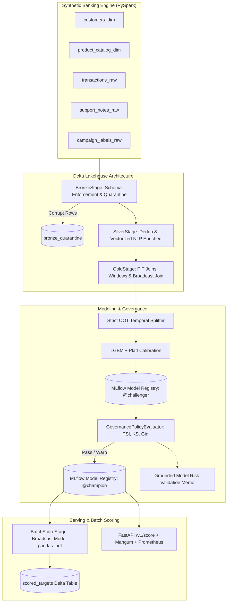

# CreditTarget Architecture & Platform Design

## 1. System Overview
**CreditTarget** is an enterprise-grade distributed banking customer targeting and model risk lifecycle platform designed for Tier-1 retail banks. It solves the critical adverse-selection problem of naive marketing propensity models by uniting:
1. **Adverse Selection Prevention:** Joint estimation of customer offer acceptance ($P_{\text{accept}}$) and credit default risk ($PD$).
2. **Expected Net Value (EV) Targeting Engine:** Direct mathematical optimization of expected net margin and capital loss.
3. **Deterministic Governance Suppression:** Strict multi-tier policy enforcement protecting regulatory distress and credit risk appetite.
4. **Lakehouse Architecture:** Medallion Delta Lake architecture (Bronze -> Silver -> Gold) with strict point-in-time (PIT) temporal join invariants.
5. **Model Risk Management (SR 11-7 / OCC 2011-12):** Grounded model validation memo generation with automated numeric reconciliation and comprehensive lineage tracking.

---

## 2. Medallion Data Flow
- **Bronze:** Explicit StructType contracts validate raw payloads; corrupt records (null primary keys, invalid credit limits, out-of-range utilization) are atomically routed into `bronze_quarantine`.
- **Silver:** Deduplication via `deduplicate_latest(df, key_cols, ingested_at_utc)`; customer support interactions are enriched via vectorized PySpark `pandas_udf` extracting sentiment, distress flags, complaint severity, and credit intent.
- **Gold:** Assembles customer features at grain `(customer_id, snapshot_month)` using strict point-in-time temporal joins (`event_ts <= snapshot_date` within 90-day lookback), Spark SQL rolling window aggregations, leak-free historical campaign features (`unboundedPreceding` to `-1`), and `BroadcastHashJoin` with `product_catalog_dim`.

---

## 3. Dual-Mode Storage & Tracking Parity
CreditTarget seamlessly supports two environments toggled via configuration:
- **Local Mode:** Local filesystem Delta Lake paths + local SQLite-backed MLflow registry (`sqlite:///artifacts/mlflow/mlflow.db`). Fully functional offline with complete `@champion` / `@challenger` alias support.
- **Cloud Mode:** AWS S3 (`s3a://...`) Delta paths + remote MLflow tracking server + Databricks runtime integration.
